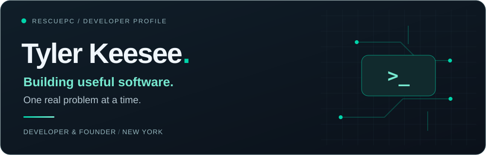
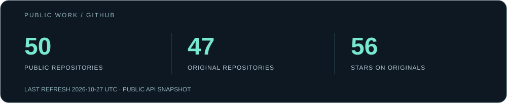

**Windows tools · Practical automation · Software that helps people**

[RescuePC ↗](https://www.rescuepcrepairs.com/) &nbsp; / &nbsp; [Portfolio ↗](https://rescuepc.github.io/Portfolio/) &nbsp; / &nbsp; [Get in touch ↗](mailto:keeseetyler@yahoo.com)

## Hey, I'm Tyler.

I'm a developer, Computer Science student, and the founder of **RescuePC**, based in New York. I build tools to make everyday technology easier to understand, maintain, and use.

My work starts with a practical problem: a PC that needs troubleshooting, a repetitive task that takes too long, or a concept that could be easier to learn. I like turning those problems into software people can actually use.

**Explore:** [Selected work](#selected-work) · [My toolkit](#my-toolkit) · [What drives me](#what-drives-me) · [On GitHub](#on-github) · [Connect](#lets-connect)

## Selected work

<table>
<tr>
<td width="50%" valign="top">

### 🛠️ RescuePC Repairs

Proprietary Windows repair software for diagnostics, driver management, security scanning, and system maintenance. The product behind my business; source code is private.

**Windows · PowerShell · Automation**

[Explore RescuePC ↗](https://www.rescuepcrepairs.com/)

</td>
<td width="50%" valign="top">

### 📡 Hardware Analyzer Pro

A desktop hardware monitor for CPU, memory, GPU, storage, and network metrics, with live graphs and export tools.

**Python · PyQt6 · System monitoring**

[Explore the code ↗](https://github.com/RescuePC/Hardware-Analyzer-Pro)

</td>
</tr>
<tr>
<td width="50%" valign="top">

### 🧠 PyLearn IDE

A browser-based Python learning environment with an editor, interactive console, and visual tools for exploring programming concepts.

**JavaScript · Brython · Learning tools**

[Explore the code ↗](https://github.com/RescuePC/PyLearn-IDE)

</td>
<td width="50%" valign="top">

### 🌐 Personal Portfolio

A home for my web apps, experiments, and learning projects, from budgeting tools to interactive games.

**HTML · CSS · JavaScript**

[Visit the portfolio ↗](https://rescuepc.github.io/Portfolio/) · [Repository ↗](https://github.com/RescuePC/Portfolio)

</td>
</tr>
</table>

[Browse all public repositories →](https://github.com/RescuePC?tab=repositories)

## My toolkit

| Area | Languages & tools |
| :--- | :--- |
| Desktop & automation | Python, PowerShell, Windows, PyQt6 |
| Web | JavaScript, TypeScript, HTML, CSS |
| Development | Git, GitHub, VS Code, Vercel |
| Exploring & learning | C, C++, Java, Linux, computer science fundamentals |

## What drives me

- **Useful tools.** Build around real troubleshooting and workflow problems.
- **Thoughtful engineering.** Keep improving reliability, performance, and security.
- **Learning by doing.** Connect Computer Science coursework with hands-on projects.
- **Building a business.** Keep developing RescuePC alongside work and school.

## On GitHub

<!-- STATS:START -->
**50 public repositories · 47 original repositories · 56 stars on originals**  
Updated 2026-10-31 (UTC).
<!-- STATS:END -->

Daily snapshot from GitHub's public API. Stars are counted across original public repositories; forks are excluded from that total. The date above shows the last successful refresh. [How it updates](docs/profile-maintenance.md).

## Let's connect

Interested in Windows tools, automation, or a project we could build together? I'd love to hear from you.

**[Email](mailto:keeseetyler@yahoo.com)** · **[LinkedIn](https://www.linkedin.com/in/tyler-keesee-677baa326/)** · **[RescuePC](https://www.rescuepcrepairs.com/)** · **[Portfolio](https://rescuepc.github.io/Portfolio/)**

[YouTube](https://www.youtube.com/@RescuePCOfficial) · [X](https://x.com/RescuePCRepair) · [TikTok](https://www.tiktok.com/@rescuepcofficial)

---

Build with purpose. Learn by doing. Keep making it better.

